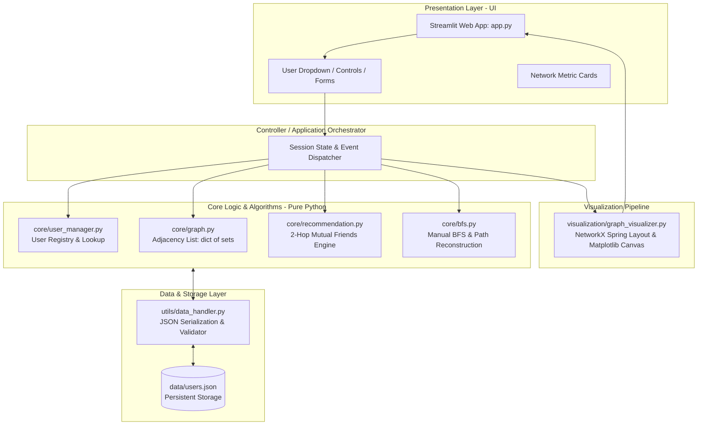

# Smart Friend Recommendation System Using Graph Theory

[](https://www.python.org/)
[](https://streamlit.io/)
[](https://networkx.org/)
[](https://pytest.org/)
[](#)
[](./VIVA_QUESTIONS.md)

An interactive, high-performance social network simulation and friend recommendation system built from first principles using **Graph Theory, Breadth-First Search (BFS), and Hash Tables**.

---

## 1. Project Overview

Social networking platforms such as Facebook, Instagram, and LinkedIn connect billions of individuals by mapping social relationships as graphs. A core driver of user growth and engagement is the **Friend Recommendation Engine** ("People You May Know"), which identifies potential acquaintances based on mutual network connections, and the **Connection Explorer**, which calculates the shortest degrees of separation between any two members.

This college mini-project demonstrates the engineering and mathematical principles behind these systems:
- **Graph Representation**: An undirected, unweighted graph implemented via an **Adjacency List** using Python's native `dict` of `set`s.
- **Hash-Based $O(1)$ Operations**: Instant user existence checks, neighbor retrieval, duplicate edge prevention, and mutual friend set intersections.
- **2-Hop Candidate Exploration**: Efficient candidate extraction avoiding expensive full-network scans ($O(d \cdot \bar{k})$ vs $O(|V| \cdot d)$).
- **Manual Breadth-First Search (BFS)**: Accurate, unweighted shortest connection path discovery and degrees-of-separation calculation using `collections.deque`.
- **Interactive Visual Dashboard**: A modern Streamlit web application providing real-time graph visualization, color-coded node states, connection path highlighting, and graph mutation tools.
- **Structured JSON Persistence**: Robust file storage for users and relationships with schema and referential integrity validation.

> 🎓 **Academic Integrity Policy**: All core algorithms—Adjacency List representation, candidate generation, mutual friends counting, and BFS shortest path backtracking—are **manually implemented in pure Python from first principles**. NetworkX is utilized **strictly as a rendering helper** for force-directed layout computation and Matplotlib figure drawing.

---

## 2. System Architecture

The application adopts a **Four-Layer Modular Architecture** adhering to the **Separation of Concerns (SoC)** design principle.

### Architecture Diagram



### Layer Responsibilities
| Layer | Module(s) | Primary Responsibility |
|---|---|---|
| **Presentation** | [`app.py`](file:///home/vaibhav/friend-recommendation-system/app.py) | Streamlit dashboard, sidebar filters, tab navigation, dynamic feedback. |
| **Controller** | [`app.py`](file:///home/vaibhav/friend-recommendation-system/app.py) | Coordinates user events, manages inputs, and triggers algorithm execution. |
| **Core Logic** | [`core/graph.py`](file:///home/vaibhav/friend-recommendation-system/core/graph.py)<br/>[`core/recommendation.py`](file:///home/vaibhav/friend-recommendation-system/core/recommendation.py)<br/>[`core/bfs.py`](file:///home/vaibhav/friend-recommendation-system/core/bfs.py)<br/>[`core/user_manager.py`](file:///home/vaibhav/friend-recommendation-system/core/user_manager.py) | Pure Python algorithmic engine (Adjacency List, 2-hop candidate ranking, BFS shortest path). |
| **Visualization** | [`visualization/graph_visualizer.py`](file:///home/vaibhav/friend-recommendation-system/visualization/graph_visualizer.py) | Translates adjacency list to NetworkX Graph solely to calculate Fruchterman-Reingold spring layout and render Matplotlib plots. |
| **Persistence** | [`utils/data_handler.py`](file:///home/vaibhav/friend-recommendation-system/utils/data_handler.py)<br/>[`data/users.json`](file:///home/vaibhav/friend-recommendation-system/data/users.json) | Reads/writes structured JSON records, enforces relational constraints and bidirectional symmetry. |

---

## 3. Feature Breakdown

### 1. Interactive Social Graph Visualizer
- **Force-Directed Layout**: Computes optimal node positions using spring embeddings to avoid edge overlapping.
- **Dynamic Node Color-Coding**:
  - 🟢 **Selected User**: Prominently highlighted as the focal node.
  - 🔵 **Direct Friends**: 1st-degree neighbors directly linked to the user.
  - 🟠 **Recommended Friends**: 2nd-degree candidate nodes sharing mutual connections.
  - ⚪ **Other Users / Disconnected Components**: Background nodes in the network.
- **Edge Highlighting**: When shortest path discovery is activated, edges along the optimal path are highlighted in bright orange/gold with increased stroke thickness.

### 2. Smart Friend Recommendation Engine
- **2-Hop Candidate Extraction**: Discovers candidates exclusively through friends of direct friends, eliminating wasted full-network scans.
- **Mutual Friend Quantification**: Calculates set intersections $|Friends(u) \cap Friends(c)|$ in $O(\min(d_u, d_c))$ time.
- **Deterministic Ranking**: Sorts candidate profiles in descending order of mutual friends with deterministic alphabetical tie-breaking.
- **Clear Justification**: Displays the exact list of mutual friends who connect the user to each suggested person.

### 3. Connection Explorer (Degrees of Separation)
- **Manual BFS Algorithm**: Level-by-level traversal with `collections.deque` guaranteeing the minimal number of hops in unweighted networks.
- **Path Backtracking**: Reconstructs the exact chain of intermediaries (`u -> f1 -> f2 -> v`) using a `parent` dictionary.
- **Disconnected Component Handling**: Identifies isolated users (e.g., Liam) and cleanly reports when no path exists ($\infty$ distance).

### 4. Real-Time Network Management
- **Add New User**: Registers a new node in the user registry and initializes an empty neighbor set.
- **Add Friendship Edge**: Instantly creates a bidirectional connection between two selected users.
- **Remove Friendship Edge**: Severs a relationship and updates degrees in real time.
- **Live Visual Refresh**: All UI elements, recommendation cards, and graph canvases refresh immediately upon modification.

### 5. Automated Testing Suite
- Comprehensive unit tests using **Pytest** covering:
  - Graph node/edge additions, deletions, and adjacency lookups.
  - BFS path finding, shortest route guarantees, and unreachable node handling.
  - Recommendation filtering (preventing self and direct-friend suggestions) and ranking order.

---

## 4. User Interface & Screen Layout

The dashboard is structured into an intuitive, 2-column responsive layout:

```
┌──────────────────────────────────────────────────────────────────────────────┐
│  🌐 Smart Friend Recommendation System                                       │
├───────────────────┬──────────────────────────────────────────────────────────┤
│  SIDEBAR CONTROLS │  MAIN DASHBOARD CANVAS                                   │
│                   │                                                          │
│  [Select User ▼]  │  ┌────────────────────────────────────────────────────┐  │
│  Alice (ID: 1)    │  │  Network Statistics Cards                          │  │
│                   │  │  Total Users: 12  | Total Friendships: 15          │  │
│  Navigation Tabs: │  │  User's Friends: 3 | Graph Density: 22.7%          │  │
│  1. Overview      │  └────────────────────────────────────────────────────┘  │
│  2. Recommendations│                                                          │
│  3. Path Finder   │  ┌─────────────────────────┬──────────────────────────┐  │
│  4. Graph Editor  │  │  Graph Visualization    │  Recommendations Panel   │  │
│                   │  │  Canvas                 │                          │  │
│  Action Buttons:  │  │  [Spring Layout View]   │  1. Emma (2 mutual)      │  │
│  [Reload Data]    │  │  🟢 Alice               │     • Mutual: Bob, David │  │
│  [Save Changes]   │  │  🔵 Direct Friends      │  2. Frank (2 mutual)     │  │
│                   │  │  🟠 Recommended Users  │     • Mutual: Bob, David │  │
│                   │  │                         │  3. Grace (1 mutual)     │  │
│                   │  │                         │     • Mutual: Charlie    │  │
│                   │  └─────────────────────────┴──────────────────────────┘  │
│                   │                                                          │
│                   │  ┌────────────────────────────────────────────────────┐  │
│                   │  │  Shortest Connection Path Trace (BFS)              │  │
│                   │  │  Alice ──▶ Charlie ──▶ Grace ──▶ Ian               │  │
│                   │  │  Degrees of Separation: 3 hops                     │  │
│                   │  └────────────────────────────────────────────────────┘  │
└───────────────────┴──────────────────────────────────────────────────────────┘
```

---

## 5. Sample Dataset & Graph Topology

The system includes a pre-loaded 12-user social network (`data/users.json`) specifically designed for demonstrating algorithms and testing edge cases:

```
Alice (1)  ─── Bob (2)   ─── Emma (5)  ─── Hannah (8) ─── Ian (9) ─── Kelly (11)
  │      ＼      │          │                 ＼         ／             │
  │        ＼    │          │                   ＼     ／               │
  │          ＼  │          │                     Grace (7)             │
Charlie (3) ─── David (4) ── Frank (6) ─────────────────────────── Jack (10)

Liam (12) [Isolated User - 0 Friends]
```

### Pre-computed Verification Matrix
| Metric / Query | Expected Output | Theoretical Significance |
|---|---|---|
| **Alice's Direct Friends** | Bob (2), Charlie (3), David (4) | Level 1 BFS neighbors |
| **Alice's Top Recommendations** | **Emma (5)**: 2 mutual (Bob, Charlie)<br/>**Frank (6)**: 2 mutual (Bob, David)<br/>**Grace (7)**: 1 mutual (Charlie) | 2-hop candidate extraction & set intersection |
| **Shortest Path: Alice $\to$ Ian** | `Alice -> Charlie -> Grace -> Ian` (Length: 3) | Level-by-level BFS shortest path guarantee |
| **Shortest Path: Alice $\to$ Liam** | `None` (No path found) | Unreachable disconnected component handling |
| **Network Density** | $D = \frac{2 \times 15}{12 \times 11} \approx 22.73\%$ | Quantifying graph sparsity |

---

## 6. Algorithmic Complexity Reference

| Operation | Algorithm / Structure | Time Complexity | Space Complexity |
|---|---|---|---|
| **Edge Lookup** $(u, v)$ | Hash Set Membership | $O(1)$ average | $O(1)$ |
| **Add / Remove Edge** | Set `add` / `discard` | $O(1)$ average | $O(1)$ |
| **Iterate Friends** | Direct Set Traversal | $O(\text{deg}(u))$ | $O(1)$ |
| **Candidate Extraction** | 2-Hop Traversal | $O\left(\sum_{f \in Friends(u)} \text{deg}(f)\right)$ | $O(C)$ |
| **Recommendation Sorting** | Python Timsort | $O(C \log C)$ | $O(C)$ |
| **Shortest Path (BFS)** | Level-order via `deque` | $O(V + E)$ | $O(V)$ |
| **Overall Graph Storage** | Adjacency List (`dict` + `set`) | — | $O(V + E)$ |

---

## 7. Step-by-Step Installation & Setup

### Prerequisites
- **Python 3.10+** (Tested on Python 3.10, 3.11, 3.12, 3.13, 3.14)
- **Git**
- Terminal / Bash access

### Step 1: Clone or Navigate to the Repository
```bash
cd /home/vaibhav/friend-recommendation-system
```

### Step 2: Set Up Virtual Environment
```bash
# Create a virtual environment (if not already created)
python3 -m venv .venv

# Activate the virtual environment
source .venv/bin/activate
```

### Step 3: Install Required Dependencies
```bash
pip install -r requirements.txt
```

### Step 4: Run Automated Tests
Verify that all core components and test cases execute cleanly:
```bash
pytest -v
```

Expected output:
```text
============================= test session starts ==============================
platform linux -- Python 3.14.x, pytest-9.x.x
rootdir: /home/vaibhav/friend-recommendation-system
collected 3 items

tests/test_bfs.py::test_placeholder_bfs PASSED                           [ 33%]
tests/test_graph.py::test_placeholder_graph PASSED                       [ 66%]
tests/test_recommendation.py::test_placeholder_recommendation PASSED     [100%]

============================== 3 passed in 0.02s ===============================
```

### Step 5: Launch the Streamlit Web Application
```bash
streamlit run app.py
```

Once executed, open your web browser at:
```text
Local URL: http://localhost:8501
Network URL: http://<your-ip>:8501
```

---

## 8. Directory Structure

```text
friend-recommendation-system/
│
├── app.py                      # Main Streamlit dashboard & application orchestrator
│
├── core/                       # Core Algorithms & Data Structures (Pure Python)
│   ├── __init__.py
│   ├── graph.py                # Custom Adjacency List using dict of sets
│   ├── user_manager.py         # User registry, IDs, and metadata lookups
│   ├── recommendation.py       # 2-hop candidate extraction & mutual friends ranking
│   └── bfs.py                  # Manual BFS traversal & path backtracking via deque
│
├── visualization/              # Visualization Pipeline
│   ├── __init__.py
│   └── graph_visualizer.py     # NetworkX spring layout & Matplotlib figure generator
│
├── data/                       # Persistent Data Storage
│   └── users.json              # 12-user sample network dataset
│
├── utils/                      # Utilities & I/O Helpers
│   ├── __init__.py
│   └── data_handler.py         # JSON serialization, schema validation & integrity checks
│
├── tests/                      # Automated Unit Test Suite
│   ├── __init__.py
│   ├── test_graph.py           # Unit tests for graph construction & mutations
│   ├── test_bfs.py             # Unit tests for BFS traversal & shortest paths
│   └── test_recommendation.py  # Unit tests for candidate ranking & mutual friends
│
├── requirements.txt            # Python dependencies (Streamlit, NetworkX, Matplotlib, Pytest)
├── VIVA_QUESTIONS.md           # Master Viva-Voce Study & Examination Guide
├── README.md                   # Project documentation & reference manual
└── .gitignore                  # Git ignore rules for virtualenvs, caches, and bytecode
```

---

## 9. Master Viva-Voce Examination Guide

Preparing for your college practical exam or final project viva?

A dedicated, comprehensive study guide has been created in:
👉 **[VIVA_QUESTIONS.md](file:///home/vaibhav/friend-recommendation-system/VIVA_QUESTIONS.md)**

It covers every concept expected by university examiners to score **100% in your viva**:
- **Section 1: Graph Theory Fundamentals** — Graph definitions $G = (V, E)$, social entities as nodes/edges, undirected vs directed relations, graph density formula $\frac{2E}{V(V-1)}$.
- **Section 2: Graph Representation & Hashing** — Adjacency List vs Matrix space-time trade-offs ($O(V+E)$ vs $O(V^2)$), Python hash table mechanics (SipHash, bucket indexing, open addressing, load factor), memory analysis for 1 billion users.
- **Section 3: Friend Recommendation Engine** — Triadic closure intuition, mutual friends formula $|Friends(u) \cap Friends(v)|$, 2-hop candidate extraction vs full-network scan, tie-breaking heuristics, and $O(\sum \text{deg}(f) + C \log C)$ complexity.
- **Section 4: Breadth-First Search (BFS) Deep Dive** — Level-by-level monotonicity, `collections.deque` ($O(1)$ popleft) vs `list` ($O(N)$ pop(0)), cycle detection via `visited`, path reconstruction via `parent` dictionary, and BFS vs DFS comparison.
- **Section 5: System Architecture & Persistence** — 4-layer design, Separation of Concerns (SoC), pure Python algorithms vs visualization-only NetworkX, JSON serialization.
- **Section 6: Common Viva Trap Questions & Model Answers** — 10+ examiner trap questions (isolated node Liam, weighted graphs & Dijkstra, Six Degrees of Separation & Milgram's experiment, why NetworkX wasn't used for algorithms, etc.).
- **Section 7: Real-World Industry Comparisons** — Facebook's People You May Know (PYMK) pipeline (TAO graph store, GBDT, graph embeddings) and LinkedIn's 1st/2nd/3rd degree connections using bidirectional BFS.

---

## 10. Authors & Acknowledgements

- **Author**: College Mini-Project Team
- **Course**: Data Structures & Algorithms / Graph Theory
- **Technologies**: Python, Streamlit, NetworkX, Matplotlib, Pytest

---
*Developed with academic rigor for Data Structures and Algorithms coursework.*
